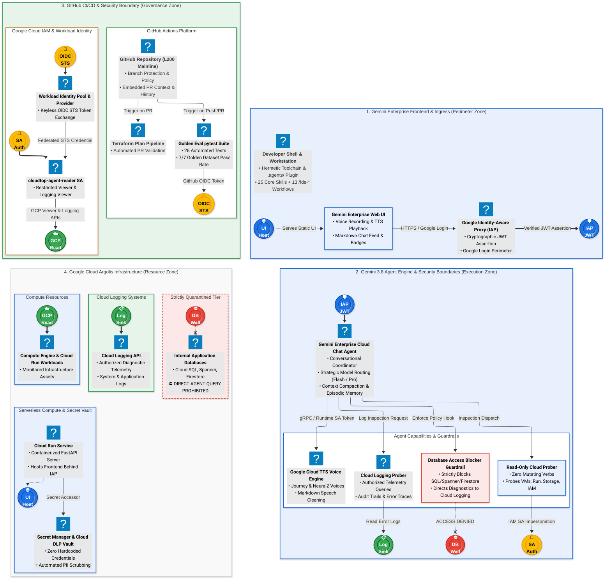

# Gemini Enterprise Cloud Chat Agent & Argolis Infrastructure Architecture

This document serves as the authoritative architectural blueprint for the Google Academy L200, Argolis, and **Gemini Enterprise (GE) Cloud Chat Agent** workspace.

---

## Canonical Architecture Diagram

> **Authoritative Architecture Platform**: **Mermaid** (`mermaid` diagram standard)  
> **Standalone Diagram Source**: [`docs/architecture_diagram.mmd`](architecture_diagram.mmd)  
> **Last Synchronized**: 2026-10-16

### System Architecture Topology

---

## Architectural Breakdown & Core Subsystems

### 1. Ingress & Client Presentation (Zone 1)
- **Gemini Enterprise Web Frontend** ([`ge-cloud-chat-frontend.md`](knowledge_base/codebase/ge-cloud-chat-frontend.md)):
  - Built with clean Material Design 3 tokens and Google Sans styling.
  - Supports speech input via browser Web Speech API (`SpeechRecognition`).
  - Spoken audio response playback via integrated HTML5 Web Audio controls and auto-play toggle.
  - Live status badges reflecting Gemini 3.8 Flash, verified IAP identity, and active database quarantine.
- **Identity-Aware Proxy (IAP) Gateway** ([`iap-verifier.md`](knowledge_base/codebase/iap-verifier.md)):
  - Cryptographically validates `X-Goog-IAP-JWT-Assertion` and `X-Goog-Authenticated-User-Email`.
  - Enforces role-based caller authorization before forwarding requests to the conversational agent.

### 2. Conversational Agent Engine & Security Boundaries (Zone 2)
- **Gemini Enterprise Cloud Chat Agent** ([`a2a-software-factory-api.md`](knowledge_base/codebase/a2a-software-factory-api.md)):
  - Single conversational coordinator running Gemini 3.8 Flash for fast telemetry and Gemini 3.8 Pro for deep architectural synthesis.
  - Maintains persistent episodic memory and dynamic context compaction across multi-turn sessions.
- **Google Cloud Text-to-Speech (TTS)** ([`cloud-tts-service.md`](knowledge_base/codebase/cloud-tts-service.md)):
  - Synthesizes Journey and Neural2 voices with automatic markdown-to-speech cleaning.
- **Strict Database Access Restriction Guardrail** ([`database-access-blocker-guardrail.md`](knowledge_base/codebase/database-access-blocker-guardrail.md)):
  - Intercepts and denies direct SQL/Spanner/Firestore queries while directing diagnostic workflows to Cloud Logging.
- **Read-Only Cloud Inspection Tools**:
  - Zero mutating verbs; inspects Compute Engine VMs, Cloud Run services, Storage bucket metadata, IAM roles, and Cloud Logging entries.

### 3. Google Cloud Argolis Infrastructure & Observability (Zone 4)
- **Cloud Run Service**: Containerized FastAPI service deployed behind Identity-Aware Proxy.
- **Cloud Logging Systems**: Permitted diagnostic log stream providing error traces and audit trails.
- **Secret Manager & Cloud DLP Vault**: Zero hardcoded credentials with automated PII scrubbing.
- **Internal Databases (Quarantined)**: Application databases (Cloud SQL, Spanner, Firestore) strictly isolated from agent query access.
- **IAM Permission Boundary Governance**: Project-level IAM member bindings are gated behind `manage_project_iam` (default: `false`) ensuring keyless WIF deployment pipelines operating under `roles/editor` apply infrastructure without encountering 403 `setIamPolicy` denials.
- **Declarative State Import & GCS Backend**: Declarative `import {}` blocks ([`terraform/imports.tf`](../terraform/imports.tf)) adopt pre-existing Argolis cloud resources into the remote GCS state backend (`l200-509515-tfstate`), eliminating 409 conflict errors across ephemeral GitHub Actions CI/CD runners.

---

## Operational Knowledge Framework (OKF) Catalog

Every architectural component is documented in [`docs/knowledge_base/`](knowledge_base/):
- **Web Frontend**: [`docs/knowledge_base/codebase/ge-cloud-chat-frontend.md`](knowledge_base/codebase/ge-cloud-chat-frontend.md)
- **IAP Verifier**: [`docs/knowledge_base/codebase/iap-verifier.md`](knowledge_base/codebase/iap-verifier.md)
- **Cloud TTS Service**: [`docs/knowledge_base/codebase/cloud-tts-service.md`](knowledge_base/codebase/cloud-tts-service.md)
- **Database Guardrail**: [`docs/knowledge_base/codebase/database-access-blocker-guardrail.md`](knowledge_base/codebase/database-access-blocker-guardrail.md)
- **Pre-Push Credential & OSPO Sanitization Gate**: [`docs/knowledge_base/cloudtop_env/scripts/pre-command-hook.md`](knowledge_base/cloudtop_env/scripts/pre-command-hook.md)
- **Argolis WIF & Terraform State Setup Script (`~/workspace/setupScripts/`)**: [`docs/knowledge_base/cloudtop_env/scripts/setup-argolis-github-wif.md`](knowledge_base/cloudtop_env/scripts/setup-argolis-github-wif.md)
- **Argolis Zero-Privilege IAM Provisioning Script (`~/workspace/setupScripts/`)**: [`docs/knowledge_base/cloudtop_env/scripts/provision-argolis-env.md`](knowledge_base/cloudtop_env/scripts/provision-argolis-env.md)
- **FDE & Official ADK-Python Skills Catalog**: [`docs/knowledge_base/cloudtop_env/skills/fde-and-adk-skills-suite.md`](knowledge_base/cloudtop_env/skills/fde-and-adk-skills-suite.md)
